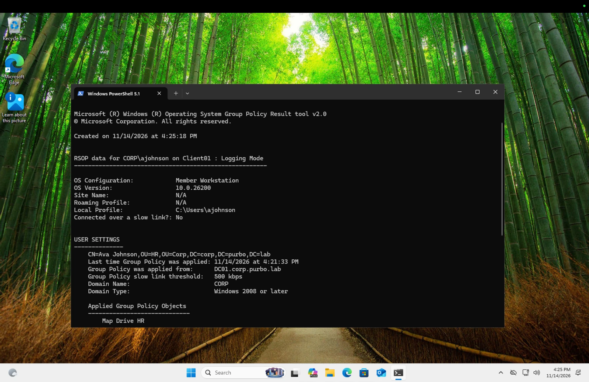
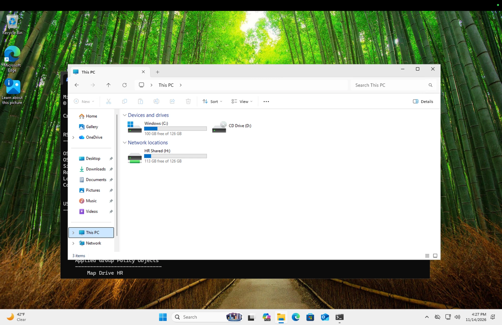
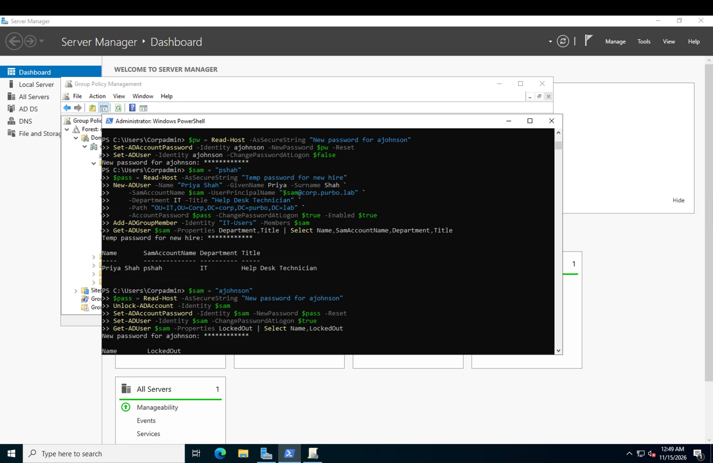
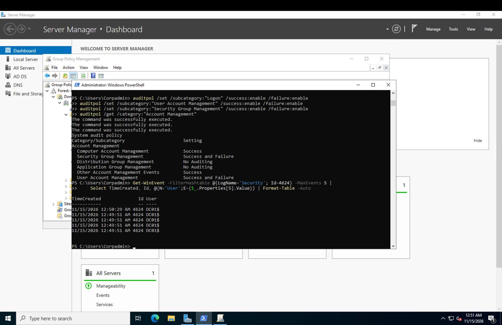
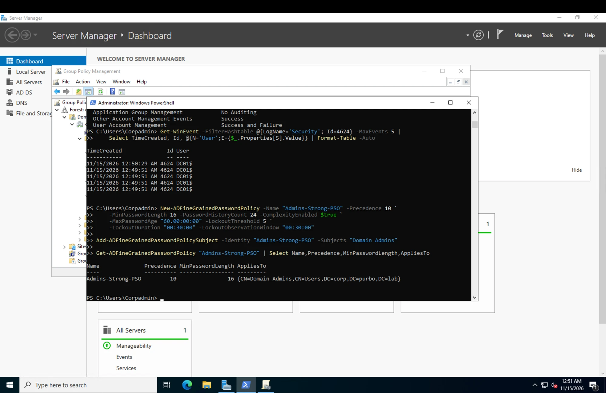
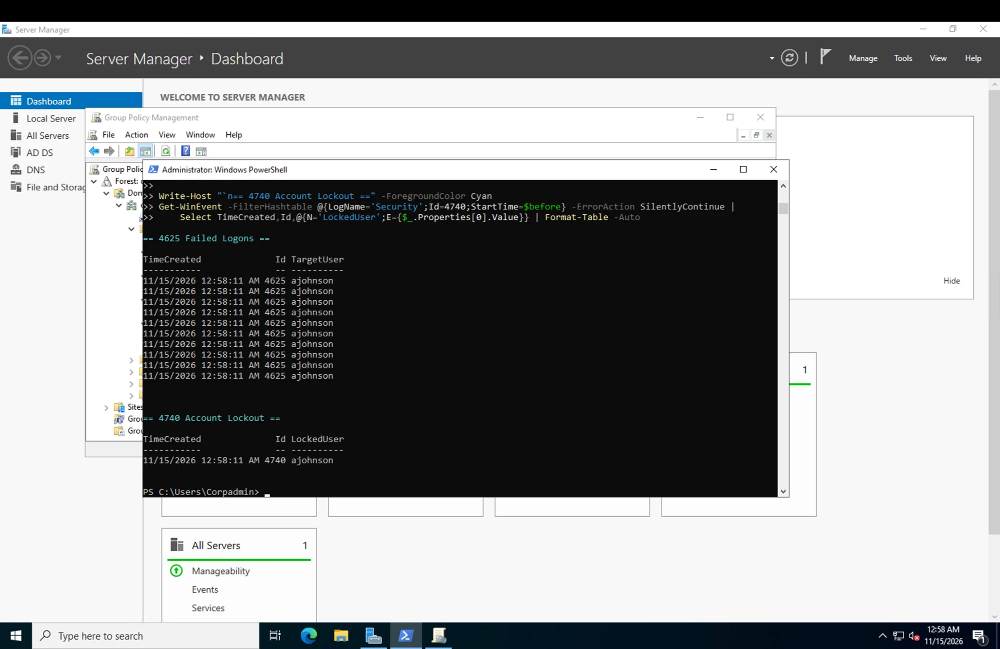

# Enterprise Identity Lab — Active Directory, Group Policy & PowerShell on Azure

A self built Windows enterprise identity environment running in Microsoft Azure.
I stood up a domain controller, built out an Active Directory forest for a
fictional company, bulk provisioned 50 users with PowerShell, enforced policy
through Group Policy, joined a client workstation, and then **secured and
tested** the environment including simulating a brute force attack and
detecting it in the Windows Security log.

**Domain:** `corp.purbo.lab`  ·  **Platform:** Azure (Windows Server 2022 DC + Windows 11 client)  ·  **Automation:** PowerShell

---

## What this demonstrates

| Area | Skills shown |
|------|--------------|
| **Infrastructure** | Azure VNet/subnet/NSG design, VM deployment, static IP, locked-down RDP, cost controls |
| **Active Directory** | Forest/domain setup, OU design, security groups, DNS, domain join |
| **Automation** | PowerShell for bulk user creation, the full user lifecycle, and hardening |
| **Group Policy** | Password/lockout policy, USB storage block, department drive mapping |
| **IT operations** | Help-desk workflows: onboarding, offboarding, password reset, access requests |
| **Security** | Audit logging, tiered password policy, least-privilege review, attack simulation & detection |

---

## Architecture

```
                         Azure  (Resource Group: rg-identity-lab, North Central US)
                         VNet: vnet-corp  10.0.0.0/16   (DNS -> 10.0.0.4)
   ┌──────────────────────────────────────────────────────────────────────┐
   │                                                                        │
   │   DC01  (Windows Server 2022)            CLIENT01  (Windows 11 Pro)     │
   │   10.0.0.4  — static                      10.0.0.5                      │
   │   • AD DS (corp.purbo.lab)   ◄───────────  • Domain member             │
   │   • DNS                       domain join  • Receives GPOs by OU        │
   │   • Group Policy / shares                  • Employee logs in here      │
   │                                                                        │
   └──────────────────────────────────────────────────────────────────────┘
        RDP in from admin IP only (NSG rule, /32)
```

### Organizational Unit design
```
corp.purbo.lab
└── Corp
    ├── IT         (+ IT-Users group)
    ├── HR         (+ HR-Users group)
    ├── Finance    (+ Finance-Users group)
    ├── Sales      (+ Sales-Users group)
    ├── Workstations      (CLIENT01 lives here — gets the USB-block policy)
    └── Disabled Users    (offboarded accounts)
```

---

## Build phases

1. **Azure foundation** — resource group, VNet, NSG, budget alert
2. **Domain controller** — deploy DC01, install AD DS, create the forest
3. **DNS** — point the VNet at the DC so clients can find the domain
4. **Structure** — OUs + one security group per department ([`01-create-structure.ps1`](scripts/01-create-structure.ps1))
5. **Users** — bulk create 50 users from CSV ([`02-bulk-create-users.ps1`](scripts/02-bulk-create-users.ps1))
6. **File shares** — per department shares, access by group (least privilege)
7. **Group Policy** — password/lockout, USB block, drive maps
8. **Client** — deploy CLIENT01, join the domain, verify policy
9. **Help-desk operations** — the user lifecycle in script ([`03-helpdesk-scenarios.ps1`](scripts/03-helpdesk-scenarios.ps1))
10. **Security hardening** — detection, defense in depth, least privilege ([`04-security-hardening.ps1`](scripts/04-security-hardening.ps1))
11. **Attack & detect** — brute force simulation + log analysis ([`05-attack-detect-demo.ps1`](scripts/05-attack-detect-demo.ps1))

Full step-by-step walkthrough: **[BUILD-GUIDE.md](BUILD-GUIDE.md)**

---

## Proof it works

**Policy follows the user by department.** Ava Johnson (HR) logs into the client
and automatically receives the HR drive map because she's in the HR OU. No
manual setup on the PC:





**Help-desk automation** — onboarding, resets and access changes in PowerShell:



---

## Security

Three defensive controls, each mapped to a core principle:

| Control | Principle | Screenshot |
|---------|-----------|------------|
| Audit logging (logons, account & group changes) | **Detection** |  |
| 16 char fine grained password policy for Domain Admins | **Defense in depth** |  |
| Privileged-group membership review | **Least privilege** | — |

### Attack simulation & detection
I ran a controlled brute-force against a lab account. It produced ten **4625**
failed logon events and tripped the lockout policy (**4740**) — all captured in
the Windows Security log, the same telemetry a SOC would alert on:



> This connects to my companion [Home SOC Lab](https://github.com/zinedPurbo/home-soc-lab):
> this environment generates the attack, and a SIEM detects it.

---

## Repository layout

```
enterprise-identity-lab/
├── README.md
├── BUILD-GUIDE.md                 # full step-by-step build
├── scripts/
│   ├── 01-create-structure.ps1    # OUs + security groups
│   ├── 02-bulk-create-users.ps1   # 50 users from CSV
│   ├── 03-helpdesk-scenarios.ps1  # onboard / offboard / reset / access
│   ├── 04-security-hardening.ps1  # audit, PSO, privileged review
│   ├── 05-attack-detect-demo.ps1  # brute-force simulation + detection
│   └── users.csv                  # 50 fictional employees
└── screenshots/                   # verified proof (no real credentials or IPs)
```

**Security note:** every script takes passwords at runtime (`Read-Host -AsSecureString`) —
no credentials are stored in any file. All user data is fictional. Screenshots
containing real IPs or account details were deliberately excluded.

---

## Future enhancements

- **Windows LAPS** — automatic rotation of local-administrator passwords
- **Microsoft Security Baselines** — apply the hardened GPO baseline for Server/Win11
- **Forward logs to a SIEM** — ship the Security log to the SOC lab for live alerting
- **Tiered admin model** — separate daily-use and privileged admin accounts
